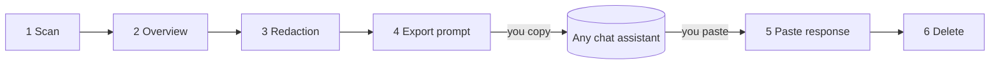

# Ullage

A privacy-first disk space analyzer for Windows, for any kind of user. It scans your drives
locally, shows its interface in your browser on `127.0.0.1`, and uses AI only through
copy and paste: you decide what text leaves your PC, and the program itself never makes
an outbound network connection.

(*Ullage* is the empty space at the top of a cask or bottle, the part that is not
filled.)

## How it works



1. **Scan** drives or folders. Sizes are what files really occupy on disk (compression,
   sparse files, hard links counted once, cloud placeholders counted as not stored here).
2. **Overview**: every byte is in one tier. *System* (Windows, page file...) is never
   touched; *Known* items are recognized by built-in recipes (package caches, browser
   caches, Docker and WSL disks...); everything else is *Unknown*.
3. **Redaction**: choose what the assistant may not see. Your user name, machine name
   and profile path are always hidden. Rules are stored encrypted with Windows DPAPI.
4. **Export**: Ullage writes a compact, redacted list of the large Unknown items with
   numeric IDs. You copy it into any assistant (Claude, ChatGPT, ...).
5. **Paste** the reply. Ullage validates it strictly: the reply can only name IDs from
   the prompt and choose from fixed values. Anything else is rejected, with a repair
   prompt to send back.
   The reply explains every category it suggests deleting: what it is, what is lost and
   how to free the space safely.
6. **Delete**: recipe and AI categories, largest first, each with its explanation and
   with real names shown again locally. Select what to delete; every item is checked
   against the disk again right before deletion. Recycle Bin by default; permanent
   deletion needs you to type a confirmation. Where a tool's own cleanup is the better
   way (for example `rustup` for Rust toolchains), it is shown first, and deleting
   directly carries a ⚠ warning about what it may break.

## Safety and privacy

- **No outbound network.** No telemetry, update checks or remote assets. A build check
  rejects networking code, a runtime guard disables Go's HTTP client and DNS, and the
  page's Content Security Policy blocks remote loads.
- **Local server hardening.** It listens on `127.0.0.1` only, on a random port, behind a
  per-launch token. Requests with the wrong Host or Origin are refused, and state
  changes need POST with the token in a header.
- **The AI never authors actions.** Replies are untrusted input. Ullage builds every
  deletion itself, from IDs that exist in the current scan. AI cleanup advice is shown
  as text and is never executed.
- **Protected locations.** Ullage never deletes in the System tier, under `C:\Windows`
  or Program Files, outside the scanned folders, or any profile or folder containing
  one.
- **Changes block deletion.** Any change since the scan blocks an item: size, files,
  modification time, or a folder replaced by a link.
- **Fail closed.** If the redaction rules cannot be read, no prompt is generated.
- **Cloud-synced items** (OneDrive and similar) can be deleted, but Ullage warns that this
  also deletes the cloud copy.

## Install and run

1. Download `ullage-<version>-windows-amd64.exe` from
   [Releases](https://github.com/Toldry/Ullage/releases) (`arm64` for Windows on ARM).
   It is one file, with no installer. Put it where you keep programs, for example
   `%LOCALAPPDATA%\Programs\Ullage\`, and you may rename it to `ullage.exe`.
2. Run it. Your browser opens on a local, one-time link. The first run adds
   **Ullage** to the Start menu.
3. Running it again while it is open just opens a new tab of the same session. It exits
   by itself 15 minutes after the last tab closes.

To verify a download, compare its checksum with `SHA256SUMS.txt` from the same
release. While the repository is public you can also check that GitHub built it from
this repository:

```powershell
Get-FileHash .\ullage-0.1.0-windows-amd64.exe -Algorithm SHA256
gh attestation verify .\ullage-0.1.0-windows-amd64.exe --repo Toldry/Ullage
```

```sh
sha256sum -c SHA256SUMS.txt --ignore-missing
gh attestation verify ullage-0.1.0-windows-amd64.exe --repo Toldry/Ullage
```

To read folders that need administrator rights, use *Relaunch as administrator* on the
Scan screen.

Command line options: `--version`; `--no-browser` prints the link instead of opening it;
`--install-shortcut` and `--remove-shortcut` manage the Start menu entry.

### Where Ullage keeps data

| What | Where |
|------|-------|
| Settings | `%APPDATA%\Ullage\config.json` |
| Redaction rules (encrypted, DPAPI) | `%APPDATA%\Ullage\rules.dpapi` |
| History: dates, drives and sizes, no paths (encrypted, DPAPI) | `%LOCALAPPDATA%\Ullage\history.dpapi` |
| Logs, 14 days, with redacted paths | `%LOCALAPPDATA%\Ullage\logs\` |
| Start menu shortcut | `%APPDATA%\Microsoft\Windows\Start Menu\Programs\Ullage.lnk` |

To uninstall, run `ullage.exe --remove-shortcut`, delete the executable, and delete the
two `Ullage` folders above (`%APPDATA%\Ullage` and `%LOCALAPPDATA%\Ullage`).

## Building

Requirements: Go 1.24+ and Node.js 22+ (build time only). The result is one
self-contained `bin\ullage.exe`.

```sh
scripts/build.sh            # Linux, macOS, Git Bash
```

```powershell
scripts\build.ps1           # PowerShell
```

## Releasing

Releases are automatic. Every push to `main` that changes the program (anything but
`docs/`, `AGENTS.md` and the CI workflow) runs the
[Release workflow](.github/workflows/release.yml): it tests everything, builds `amd64`
and `arm64` executables, smoke-tests one, packages zips with the README and
`THIRD-PARTY-NOTICES.txt`, writes `SHA256SUMS.txt`, attests build provenance (public
repository only) and publishes the GitHub Release with notes listing the changes.

The version comes from the highest `vX.Y.Z` tag. Each release bumps the patch number by
default. Markers in a commit's subject line (any commit since the last release) change
that; the message body is ignored, so it can mention them freely:

| In a subject line   | Effect                      |
| ------------------- | --------------------------- |
| `[minor]`           | `0.1.4` → `0.2.0`           |
| `[major]`           | `0.1.4` → `1.0.0`           |
| `[skip release]`    | no release for this push (head commit only) |

To publish an exact version instead, such as a pre-release, push its tag. A version
with a suffix (`0.2.0-beta.1`) becomes a pre-release, and a commit that already carries
a tag is not released again. Running the workflow by hand rehearses everything without
publishing.

```sh
git tag v0.2.0-beta.1
git push origin v0.2.0-beta.1
```

## Testing

```sh
cd web && npm ci && npm test && cd ..
go test ./...    # includes the no-outbound-network build check and an API end-to-end test
```

The Windows-only tests cover:

- junctions, NTFS compression, sparse files and ACL-denied folders;
- DPAPI;
- the real Recycle Bin;
- the single-instance pipe;
- the Start menu shortcut.

They run on `windows-latest` in CI. `go run ./tools/tokenestimate` estimates prompt sizes
offline; it is a development tool and not part of the app.

## Documentation

[Architecture](docs/ARCHITECTURE.md), [requirements](docs/requirements.md),
[decisions](docs/decisions.md), [design conflicts](docs/design-conflicts.md) and the
[phase plan](docs/phases.md).
