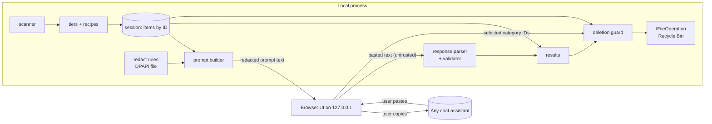

# Ullage architecture

Ullage is a Windows-only, privacy-first disk space analyzer for developers. A local program
scans drives, serves a browser UI on `127.0.0.1`, and uses AI only through manual copy-paste.
The program never makes an outbound network connection.

This document describes the stack, module layout, data flow and storage locations. It
started as the Phase 0 deliverable and is kept current as phases land.

---

## 1. Stack decision

| Layer     | Choice                                                                 |
|-----------|------------------------------------------------------------------------|
| Backend   | **Go 1.24**, pure Go (no cgo), `golang.org/x/sys/windows` for Win32    |
| HTTP      | Go standard library `net/http` server, bound to `127.0.0.1:0`          |
| Frontend  | **Preact + TypeScript**, built with **Vite** at development time only  |
| Embedding | `go:embed` of the built `web/dist` directory and bundled font files    |
| Fonts     | IBM Plex Sans and IBM Plex Mono `.woff2` files committed to the repo   |
|           | (SIL Open Font License 1.1, which permits bundling)                    |
| Recipes   | Embedded `.toml` data files, one per recipe, validated at startup     |
| Tests     | `go test` (Windows CI runner for Win32 fixtures), Vitest for the UI   |

### 1.1 Evaluation against the criteria

**Single Windows executable, no runtime install.** Go produces one statically linked
`ullage.exe` (about 10-15 MB including assets) with no dependency beyond system DLLs.
`-H windowsgui` suppresses the console window. Cross-compilation (`GOOS=windows`) works from
any host, which matters because the reference development container is Linux.

**Win32 API access.** `golang.org/x/sys/windows` already wraps most of what we need:

| Need                                   | API                                                     |
|----------------------------------------|---------------------------------------------------------|
| Directory enumeration with file IDs    | `GetFileInformationByHandleEx(FileIdExtdDirectoryInfo)` |
| On-disk size, compressed/sparse        | `AllocationSize` from the above; `GetCompressedFileSizeW` for compressed/sparse files |
| File ID, link count, volume serial     | `GetFileInformationByHandle`                            |
| Attribute flags (reparse, recall, ...) | `FileAttributes` + `ReparsePointTag` in the dir entries |
| Junction / symlink targets             | `DeviceIoControl(FSCTL_GET_REPARSE_POINT)`              |
| Recycle Bin                            | `IFileOperation` via a small hand-written COM vtable binding |
| DPAPI                                  | `CryptProtectData` / `CryptUnprotectData` (in x/sys)    |
| Elevation check                        | `windows.GetCurrentProcessToken().IsElevated()`         |
| Long paths                             | All paths passed to Win32 as `\\?\`-prefixed UTF-16     |
| Installed applications                 | `golang.org/x/sys/windows/registry` (Uninstall keys)    |
| Start menu shortcut                    | `IShellLinkW` + `IPersistFile` via COM                  |

Functions not wrapped (`GetCompressedFileSizeW`, `SHGetKnownFolderPath` variants) are bound
with `windows.NewLazySystemDLL`, which only loads from `System32` (no DLL hijacking).

**Fast scanning of millions of files.** Goroutines map well onto parallel directory
enumeration: a bounded worker pool (default `2 x CPU`, capped at 32) pulls directories from a
queue. Each directory is enumerated with `FileIdExtdDirectoryInfo`, which returns name,
attributes, reparse tag, allocation size, end-of-file size, last write time, and the 128-bit
file ID for *every entry in one buffered call*, so ordinary files never need to be opened.
That is the main reason for this API over `FindFirstFileExW` (no file IDs) or opening each
file (one kernel round trip per file).

**Embedded, offline frontend.** `go:embed` puts the Vite build output and fonts inside the
executable. The server sets a strict Content-Security-Policy (`default-src 'self'`), so even a
regression that adds a remote URL is blocked by the browser.

### 1.2 Rejected alternatives

| Alternative            | Why rejected                                                    |
|------------------------|-----------------------------------------------------------------|
| **Rust** (`windows` crate, `axum`, `rust-embed`) | Strongest Win32 bindings (COM included) and the fastest possible scanner. Rejected narrowly: Windows cross-compilation from the Linux container needs a MinGW toolchain that is not installed, compile times slow the test loop, and the scanner is I/O bound, so Rust's CPU advantage buys little. A reasonable choice if you prefer it. |
| **C# / .NET 8** (Native AOT, ASP.NET Kestrel) | Excellent COM interop and P/Invoke. Native AOT with ASP.NET still yields 30+ MB binaries with trimming caveats, and AOT builds require a Windows host, so nothing can be built or smoke-tested in the Linux container. |
| **C++** (Win32 + embedded HTTP library) | Full API access but manual memory safety in code that parses untrusted AI responses, and much more code for HTTP, JSON, and tests. |
| **Python** (PyInstaller) | Too slow for millions of files; the "single exe" unpacks to a temp directory at launch and is often flagged by antivirus. |
| **Electron / Tauri** | The spec asks for a browser UI on localhost. Electron bundles a 100+ MB runtime; Tauri uses WebView2 (a separate runtime on older Windows 10) and blurs the "local server + any browser" model. |
| **Frontend: React** | Matches the design's component model, but Preact gives the same API at ~4 KB. `preact/compat` lets us lift design logic nearly verbatim. |
| **Frontend: vanilla JS** | No toolchain, but the design has 10+ stateful screens; hand-rolled DOM updates would be bug-prone and hard to test. |
| **Frontend: Svelte** | Fine technically; Preact keeps the design's JSX-like structure, so less translation risk. |

Node is a **development-time** dependency only. The shipped executable contains static files.
`web/dist` is git-ignored; the release build runs `npm ci && npm run build`
then `go build`.

---

## 1.3 Keeping a future Linux port cheap

Ullage targets Windows only for now, but Linux support is a likely future demand, so no
decision below may assume Windows outside one boundary:

- **One platform boundary.** Everything OS-specific lives in `internal/platform`, split by
  build tags (`*_windows.go`, `*_linux.go`). Core packages (scanner, tiers, recipes, redaction,
  prompt, parser, deletion guard) use only its portable types: `DirectoryEntry`, `FileID`,
  `Volume`, `KnownLocations`. The Linux implementation exists from Phase 1 (it backs the
  real-filesystem tests in the Linux container), so the seam is exercised, not theoretical.
- **Portable concepts, OS-specific mechanisms.**

  | Concept                 | Windows                                   | Linux (future)                    |
  |-------------------------|-------------------------------------------|-----------------------------------|
  | File identity           | volume serial + 128-bit file ID           | `st_dev` + inode                  |
  | On-disk size            | `AllocationSize` / `GetCompressedFileSizeW` | `st_blocks x 512`               |
  | Link count              | unknown during enumeration (seen-set)     | `st_nlink` (set only when > 1)    |
  | Do-not-traverse entries | junctions, symlinks, mount points         | symlinks, other filesystems       |
  | Elevated                | token elevation                           | effective UID 0                   |
  | Secret storage          | DPAPI                                     | a `SecretProtector` backend (Secret Service or a key file) |
  | Recycle Bin             | `IFileOperation`                          | freedesktop.org Trash spec        |
  | Installed apps          | Uninstall registry keys                   | package manager queries           |
  | Config directory        | `%APPDATA%\Ullage`                        | `$XDG_CONFIG_HOME/ullage`         |

- **Data, not code, for OS knowledge.** Recipes and System-tier rules list path patterns per
  OS (`[paths] windows = [...]`, `linux = [...]`) using variables such as `{UserProfile}` and
  `{LocalAppData}` that each platform expands.
- **Paths.** Stored natively; rendered with `/` separators in prompts and the UI on every OS.
  Case-insensitive comparison is a platform property, not a hard-coded assumption.

---

## 2. Module layout

```
ullage/
├── cmd/ullage/              main: start server, open browser, idle shutdown
├── internal/
│   ├── platform/            the only OS-specific code (*_windows.go, *_linux.go)
│   ├── scanner/             parallel walker, sizes, hard links, dates, file-type mix
│   ├── pathpattern/         segment-wise glob engine shared by tiers and redaction
│   ├── recipes/             recipe schema and validation; data/*.toml embedded
│   ├── tiers/               System / Known / Unknown classification during the walk
│   ├── overview/            numbers for the Overview screen
│   ├── protect/             secret storage (DPAPI on Windows), fail closed
│   ├── redact/              redaction rules, placeholders, path rendering
│   ├── session/             per-launch state: scan, session code, log, redaction
│   ├── server/              HTTP handlers, token/Host/Origin guard, SSE progress
│   ├── storage/             config file, atomic writes
│   └── nonetwork/           runtime guard that disables outbound HTTP and DNS
│   (later phases add prompt/, response/, results/, deletion/, history/)
├── web/                     Preact + TypeScript UI; dist/ is embedded by package web
├── tools/nonetwork/         build check: forbids outbound network APIs (see §6)
├── docs/                    this file, requirements, decisions, phase plan
└── .github/workflows/       CI on Windows and Linux
```

Rules for dependencies between packages: `prompt` and `response` never import `deletion`;
`deletion` accepts only scan item IDs resolved through `session`, never paths or strings
derived from AI text. This makes safety rule 3 structural rather than a convention.

## 2.1 AI-first categorization

Recipes are an optimization, not the classifier. They pre-claim a short list of items
whose meaning is certain and that need no AI (page file, WinSxS, package caches, browser
caches...). Everything else is the Unknown tier, which the AI categorizes with free-text
category names, so categories are never limited to a fixed list and work for any user: a
video editor's render caches, a lawyer's archived case folders, a streamer's raw
recordings, or a family photo library. To make that possible the prompt carries, besides
the redacted path and rounded size, the newest modification month, the creation month
and the dominant file types of each line, and its instructions are written for a general
audience rather than for developers (see decision D-012).

---

## 3. Data flow



Step by step:

1. **Launch.** `ullage.exe` acquires a named mutex. If an instance is already running, it asks
   that instance over a named pipe (current-user ACL) to mint a new launch token and open a
   browser tab, then exits.
2. **Scan.** The user picks roots (drives or folders). The scanner streams progress to the UI
   over Server-Sent Events. Each entry gets a stable `ItemID` within the session.
3. **Classify.** Recipe patterns claim Known items first; System rules claim the rest of
   `C:\Windows`, boot files, and so on; everything else is Unknown. Every byte lands in
   exactly one tier.
4. **Redact and export.** The prompt builder aggregates the Unknown tier, renders every path
   through the redactor, assigns prompt IDs, and batches. The placeholder map stays in the
   process (and in the encrypted rules file).
5. **Paste.** The parser extracts and validates. Only `(prompt ID set, closed enums, free-text
   category name)` survives; the free text is display-only and HTML-escaped.
6. **Results.** Recipe categories and AI categories are merged; real names are restored for
   display only in the local UI.
7. **Delete.** The UI sends category and item IDs. The server resolves them against the
   session, applies the guards in §5, re-verifies size and mtime, then recycles.

---

## 4. Localhost hardening

```
 ullage.exe ──ShellExecute──► http://127.0.0.1:53817/launch?t=<256-bit token>
                                      │
                       token valid and unused?
                         │ yes                         │ no
                         ▼                             ▼
            Set-Cookie: ullage=<session secret>   "This link can't open a session"
            HttpOnly; SameSite=Strict; Path=/
            303 → /   (token removed from the address bar and history)
```

- Listener on `127.0.0.1:0` (random free port); never `0.0.0.0` or `::`.
- Every request must carry the session secret (cookie for page loads and assets; the
  `X-Ullage-Token` header for API calls; the page receives the header value in a
  `<meta>` tag rendered only after cookie validation).
- `Host` must equal `127.0.0.1:<port>`. `Origin`, when present, must equal
  `http://127.0.0.1:<port>`; for POST it is required. This defeats DNS rebinding and
  cross-site requests.
- State-changing endpoints: POST only, header token required, query-string token ignored.
- Responses: `Content-Security-Policy: default-src 'self'; connect-src 'self';
  frame-ancestors 'none'`, `X-Content-Type-Options: nosniff`, `Referrer-Policy: no-referrer`,
  `Cache-Control: no-store`.
- The launch token is **single-use** (the design's invalid-link screen says "already used"),
  which is stricter than "per-launch" and compatible with it.

---

## 5. Deletion guard (safety rules 3-6)

A deletion request is a list of `ItemID`s. Each item passes, in order:

1. Exists in the current session's scan (otherwise rejected, not "skipped").
2. Tier is Known or Unknown, never System.
3. Its resolved, normalized long path is not under `%SystemRoot%`, `Program Files`,
   `Program Files (x86)` (resolved via Known Folder APIs, not hard-coded drive letters), and is
   inside one of the scanned roots. Comparison is case-insensitive on the final path after
   resolving `\\?\`, 8.3 short names, and trailing dots/spaces.
4. If it matches a recipe with brute-force disallowed, only managed steps are offered.
5. Re-stat: allocated size and last-write time must equal the scan values (for directories,
   a re-walk compares totals); any change blocks that item.
6. Recycle Bin by default; permanent deletion needs a second explicit confirmation.

Per-item outcomes (deleted, blocked-changed, blocked-protected, locked, failed) are returned
and shown exactly.

---

## 6. Enforcing "no outbound network" (safety rule 1)

No single check is complete, so we layer them:

1. **Static analysis** (`tools/nonetwork`, runs in CI and `go test`): parses the Go AST of all
   non-test packages and fails on references to `net.Dial*`, `net.Dialer`,
   `http.Get/Post/Head`, `http.Client`, `http.DefaultClient`, `http.NewRequest*`,
   `http.Transport`, `net.LookupHost` and similar resolvers, `tls.Dial`, and `exec.Command`
   (so no `curl` subprocess). An allowlist covers only `net.Listen("tcp", "127.0.0.1:0")` and
   the opener `ShellExecuteW(... "http://127.0.0.1:...")`.
2. **Dependency check:** `go list -deps ./cmd/ullage` must match an allowlist of modules.
3. **Runtime guard:** `http.DefaultTransport` is replaced at startup with a transport that
   returns an error and logs a violation; a test asserts this.
4. **Asset scan:** the embedded `web/dist` is scanned for `http://`, `https://`, `//` URLs,
   `@import url(`, and `fonts.googleapis`, failing the build on any match.
5. **Browser:** the CSP above blocks remote fetches, fonts, and images.

---

## 7. On-disk storage

All under the current user's profile. Nothing is written next to the executable.

| What                     | Location                                         | Protection          |
|--------------------------|--------------------------------------------------|---------------------|
| Config (theme, batch budget, last roots) | `%APPDATA%\Ullage\config.json`   | Plain (no paths of redacted items) |
| Redaction rules + placeholder map | `%APPDATA%\Ullage\rules.dpapi`          | DPAPI, current user |
| History (dates, bytes reclaimed, counts) | `%APPDATA%\Ullage\history.dpapi` | DPAPI, current user |
| Logs                     | `%LOCALAPPDATA%\Ullage\logs\ullage-YYYYMMDD.log` | Paths always rendered redacted |
| Scan data                | In memory only; discarded when the process exits | -                   |

- Writes are atomic: write to `*.tmp`, `FlushFileBuffers`, `MoveFileExW(REPLACE_EXISTING)`.
- Fail closed: if `rules.dpapi` exists but cannot be read or decrypted, prompt generation is
  disabled with an explanation. A missing file means "no rules yet", which is allowed but
  shown explicitly in the redaction screen.
- History is encrypted too, because even dates and freed sizes per root are private, and it
  costs nothing.

---

## 8. Key design notes

- **Hard links.** Counted once per (volume, file ID). Windows directory enumeration does not
  report link counts, so every file ID is tracked; a file with one link can never be seen
  twice, so totals equal "deduplicate when link count > 1" (decision D-004). The owner of
  shared bytes is the sighting with the smallest path, which keeps totals deterministic.
- **Reparse points.** Only mount points (junctions, mounted volumes) and symbolic links are
  links: recorded at size 0 with their target, never traversed. Cloud Files, deduplicated
  and WOF-compressed files are also reparse points but are real files and are sized.
- **Compressed and sparse files.** The directory entry's allocation is used, confirmed with
  `GetCompressedFileSizeW` for compressed, sparse, WOF and deduplicated files.
- **Small files.** Files below 1 MiB (allocated and apparent) are aggregated into their
  folder's counters; their names are never stored and therefore never leave the machine.
- **Dates.** Every node records modification and creation time. Last access time is not
  used: Windows updates it lazily or not at all, so it would mislead staleness judgments.
- **Unaccounted space.** Volume "used" minus scanned bytes. It is not a tier, since those
  bytes were never scanned (decision D-008).
- **Recycle Bin and long paths.** The shell cannot recycle some paths longer than 260
  characters. Such items are reported as "cannot recycle"; the user may choose permanent
  deletion with the extra confirmation. They are never silently deleted permanently.
- **Testing.** Pure logic runs on any OS. Win32 fixtures (junctions, hard links, sparse,
  compressed, long paths, ACL-denied folders, DPAPI, Recycle Bin) run on a
  `windows-latest` GitHub Actions runner, which is the source of truth for each phase.

---

## 9. Related documents

- [requirements.md](requirements.md): the specification and later amendments.
- [decisions.md](decisions.md): every decision with its reason and status.
- [design-conflicts.md](design-conflicts.md): where the design export and the spec disagree.
- [phases.md](phases.md): the phase plan and what each completed phase delivered.
